<div align="center">

# 🏥 MediCore HMS

**Hospital Management System**

Patients · Appointments & token queue · OPD consultation · e-Prescriptions · IPD & bed management · Pharmacy · Laboratory · Billing & insurance · Reports · Patient portal


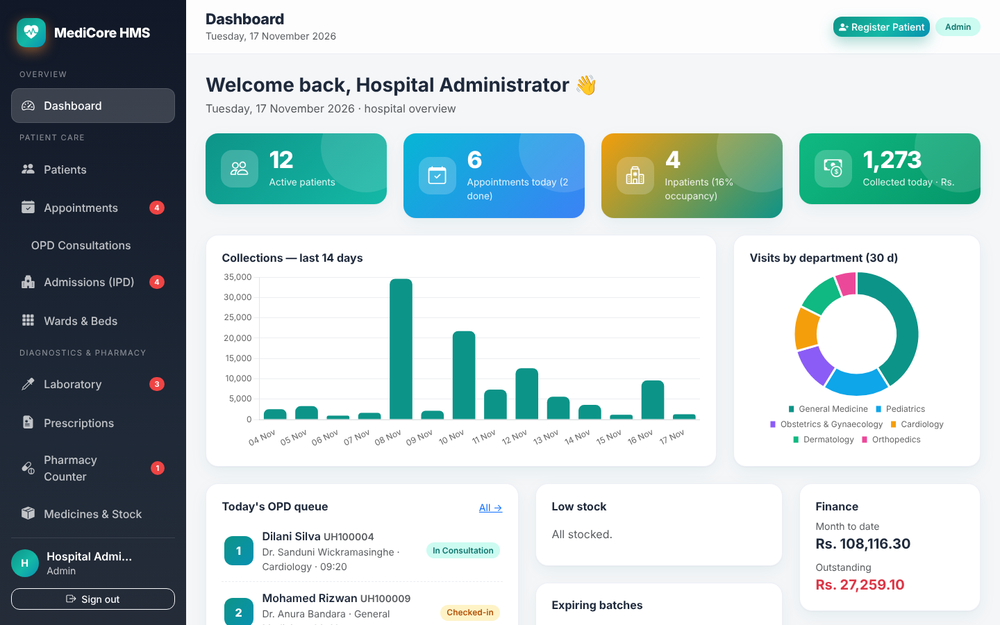

<sub>Built by **Chandra Kumar Vishanan** · HNDIT, SLIATE</sub>

</div>

## ✨ Features

| Area | What you get |
|---|---|
| **Patients** | UHID auto-numbering, demographics, allergies & chronic conditions, insurance, optional portal login, full record with visits / labs / prescriptions / admissions / billing tabs (shown per role) |
| **Appointments** | Doctor-wise time slots from each doctor's working days, race-safe booking (no double booking), daily **token queue**, check-in → in-consultation → completed, no-show / cancel |
| **OPD consultation** | Vitals, symptoms, diagnosis, **prescription builder** with allergy warnings, lab test ordering, follow-up date; completing it creates the prescription, lab order and consultation fee in one transaction |
| **IPD / Wards & beds** | Wards, beds with live status board, admit, **transfer**, nursing notes with vitals, discharge summary (PDF), per-day bed billing by segment |
| **Pharmacy** | Dispensing queue, partial dispensing, **FEFO** stock from non-expired batches, over-the-counter sales, receive stock, write-off, low-stock and **expiry alerts**; stock can never go negative |
| **Laboratory** | Test catalogue with reference ranges, sample collection, results entry with automatic **High / Low / Abnormal flags**, report PDF, abnormal-result alerts for doctors |
| **Billing** | A charges ledger fills automatically (consultation, lab, pharmacy, beds); generate invoices, discount, **insurance coverage**, partial/full payments (Cash / Card / Online), overpay protection, **PDF invoices** |
| **Reports** | Date-range revenue, collections, payment methods, revenue by source, department visits, doctor performance, top diagnoses, lab & pharmacy sales, stock value, **CSV export** |
| **Roles** | Admin, Doctor, Nurse, Receptionist, Pharmacist, Lab technician, Accountant, Patient – each with its own dashboard, menu and data scope |
| **Audit log** | Logins, billing, stock, clinical and admin actions are recorded with user and IP |
| **Security** | PDO prepared statements, `password_hash`, CSRF tokens, login lockout, role guards on pages *and* APIs, ownership checks so a patient only sees their own records |

## 🖼️ Screenshots

| OPD consultation | Pharmacy dispensing |
|---|---|
| 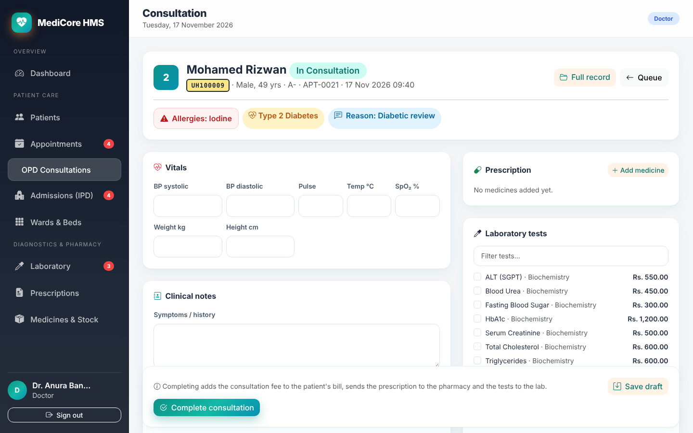 | 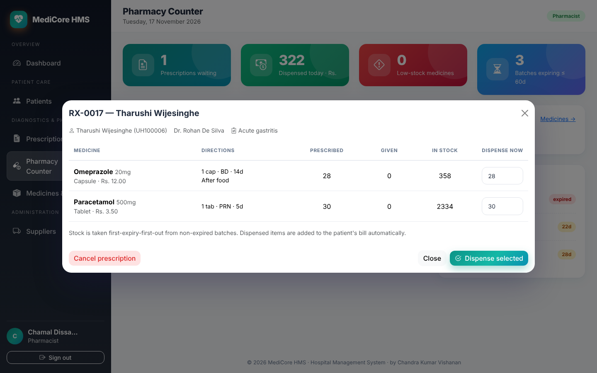 |
| **Bed board** | **Admission** |
| 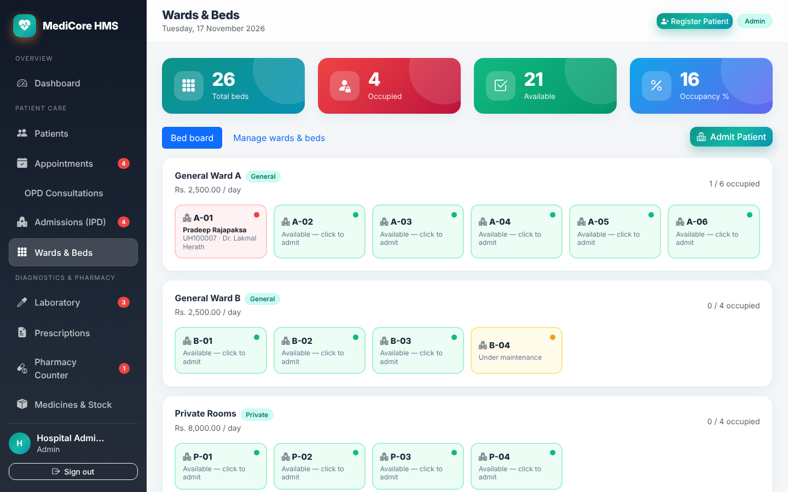 | 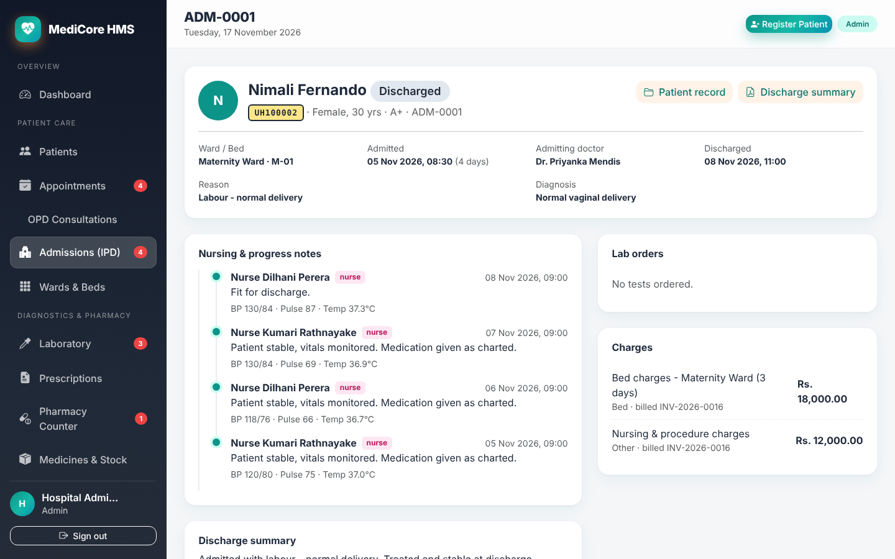 |
| **Lab results** | **Invoice** |
| 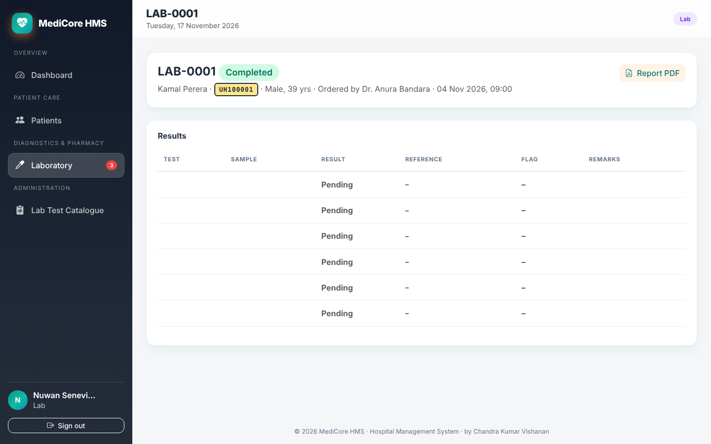 | 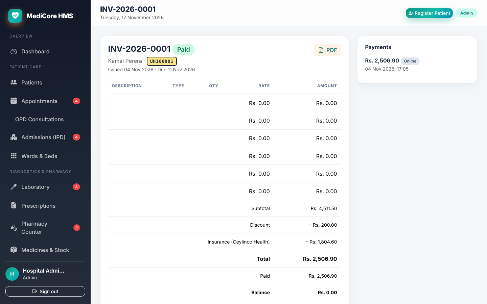 |
| **Reports** | **Patient portal** |
| 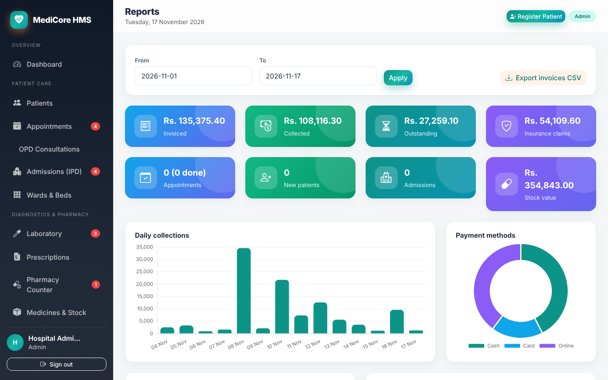 | 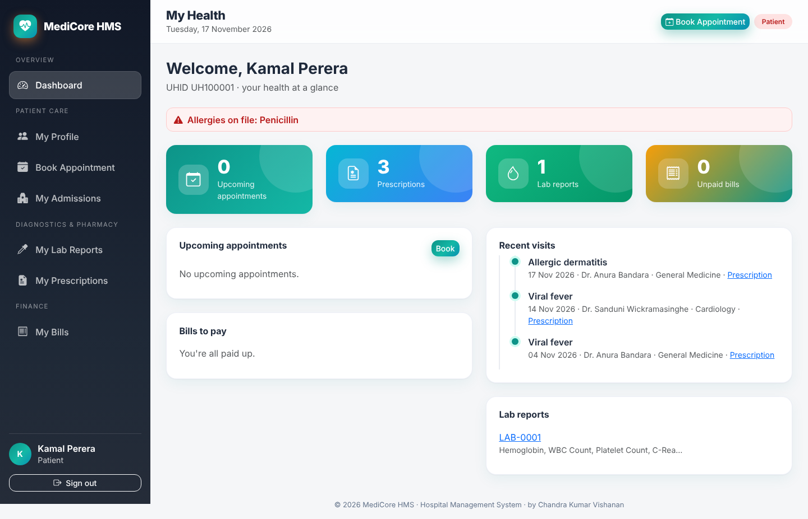 |
| **Doctor dashboard** | **Mobile** |
| 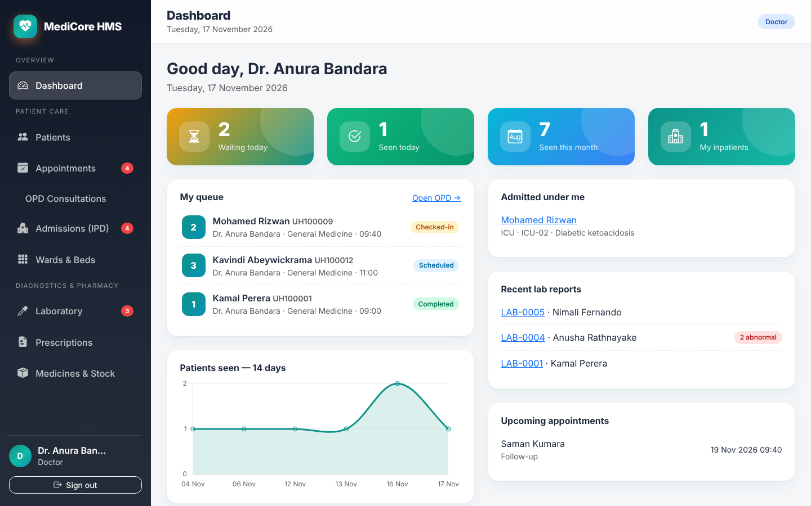 | 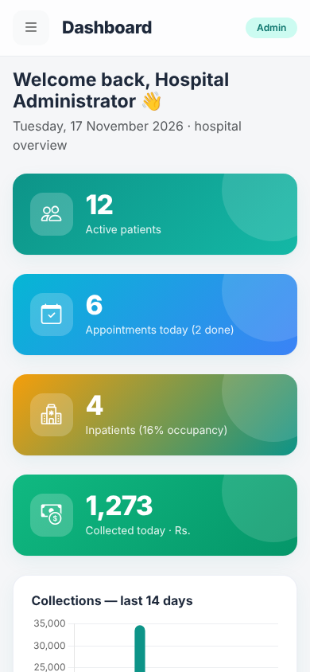 |

More in [`docs/screenshots`](docs/screenshots): patients, appointments, queue, medicines, accounts / lab / nurse / reception dashboards, audit log.

## 🧰 Tech stack

Core **PHP 8** (OOP, PDO, no framework) · **MySQL/MariaDB** · **Bootstrap 5** · vanilla JS · DataTables · Chart.js · flatpickr · FPDF · Apache `.htaccess` clean URLs

## 🚀 Install on WAMP

1. Copy the folder to `C:\wamp64\www\hospital_management`.
2. WAMP tray → Apache → Apache modules → make sure **rewrite_module** is ticked.
3. Make sure `AllowOverride All` is set for `www` (httpd.conf / httpd-vhosts.conf), then restart Apache.
4. Open **phpMyAdmin** → *Import* → choose `sql/database.sql` (it creates the `hospital_management` database with demo data).
5. Check `config/config.php` (`DB_USER`, `DB_PASS`, `DB_PORT`).
6. Visit **http://localhost/hospital_management/**

> Bootstrap, DataTables, Chart.js and flatpickr load from public CDNs, so the browser needs internet access.

## 🔑 Demo logins

| Role | Username | Password |
|---|---|---|
| Admin | `admin` | `admin123` |
| Doctor | `doctor1` – `doctor6` | `doctor123` |
| Nurse | `nurse1`, `nurse2` | `nurse123` |
| Receptionist | `reception1` | `reception123` |
| Pharmacist | `pharmacist1` | `pharmacy123` |
| Lab technician | `lab1` | `lab123` |
| Accountant | `accountant1` | `accounts123` |
| Patient | `patient1` – `patient6` | `patient123` |

## 🔄 How a patient flows through the system

```
Register → Book appointment (token) → Check-in → Nurse vitals → Doctor consultation
        ├─► Prescription ─► Pharmacy dispenses (FEFO stock) ─► charge
        ├─► Lab order ─► Sample ─► Results + flags ─► Report PDF ─► charge
        ├─► Consultation fee ─► charge
        └─► Admit to bed ─► Notes / transfer ─► Discharge summary ─► bed charges
                                    all charges ─► Invoice (discount / insurance) ─► Payments ─► Reports
```

## 📁 Structure

```
config/        config.php, db_connect.php (PDO singleton)
includes/      header, footer, auth, functions, Audit, CrudController, PdfBase, models/
modules/       dashboard, patients, appointments, opd, admissions, beds, lab, lab_tests,
               prescriptions, pharmacy, medicines, invoices, reports, doctors,
               departments, suppliers, users, audit
assets/        css/style.css, js/ (main, crud, consult, pharmacy, lab, ...)
lib/fpdf/      PDF engine
sql/           database.sql  (schema + realistic demo data)
docs/          screenshots
```

## ⚙️ Configuration

`config/config.php` holds the hospital name/address/phone, currency, invoice due days, how far ahead appointments can be booked, the medicine-expiry warning window and the default password for new patient portal logins.

## 🛡️ Before going live

- Set `APP_DEBUG` to `false`.
- Remove the demo-accounts box in `login.php` and change all default passwords.
- Serve over HTTPS and use a non-root MySQL user.
- Login lockout is session based; add IP-level throttling (e.g. at the web server) for production.
- This is a learning/portfolio project; clinical and legal requirements (data-protection, e-prescription rules) vary by country and must be reviewed before real use.

## 👨‍💻 Author

**Chandra Kumar Vishanan**
HND in Information Technology (HNDIT) – SLIATE

## 📄 License

MIT – see [LICENSE](LICENSE). © 2026 Chandra Kumar Vishanan
